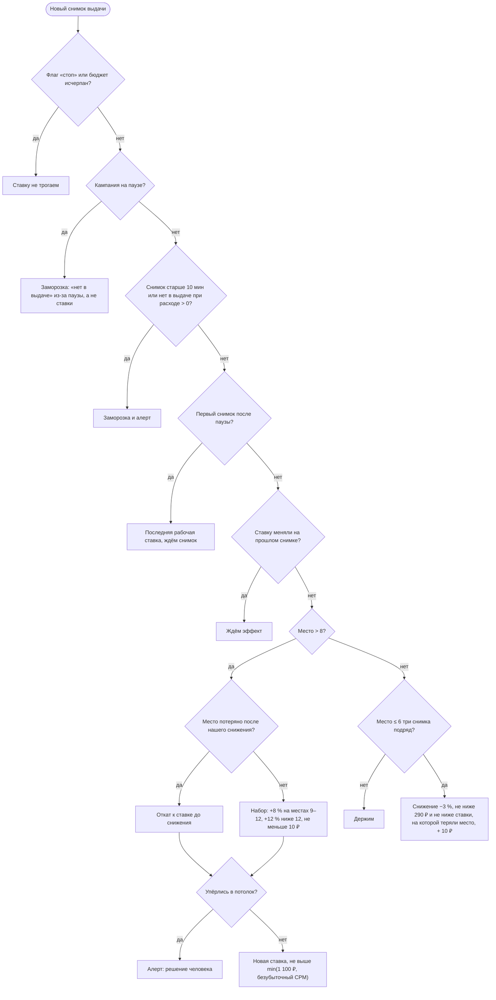

# Биддер и цена на Wildberries: разбор кейса с расчётами

[](https://www.python.org/)
[](https://github.com/unnamed00bas/wb-bidder-pricing-case/actions/workflows/tests.yml)
[](LICENSE)

## О проекте

Это моё решение тестового задания на вакансию специалиста по биддеру Wildberries. Шесть задач: цена для покупателя с СПП и WB Кошельком и «красивая» цена, эффект шага цены, удержание места в поиске (CPM) и правила биддера, разбор двух сбоев автоматики, безубыточный CPM и показатели для руководителя. Все цифры посчитаны кодом из этого репозитория и проверены тестами, полное решение с ходом мысли лежит в [PDF](docs/reshenie-wb-bidder.pdf).

## Как сделано

Для таких задач я специально создала ИИ-агента в Grok Bot — менеджера маркетплейсов WB и Ozon. Я поставила задачу, агент прочитал условия, сделал расчёты в Python и собрал документ, итог я проверила. Решение заняло около 11 минут, правки (оформление от моего лица, пояснения логики) — ещё несколько минут. Код в этом репозитории — те же расчёты, разложенные по модулям, с тестами, которые сверяют каждое ключевое число с документом.

## Задачи и результаты

| # | Задача (своими словами) | Ключевой результат |
|---|---|---|
| 1 | Посчитать цену, которую видит покупатель после скидки продавца, СПП и WB Кошелька, и подобрать базу под «красивую» цену, не выходя из акции и не попадая в карантин. Отдельно — снизить цену одного товара на 35 %. | С кошельком сейчас: А — **181 ₽**, Б — **198 ₽**, В — **856 ₽**. Красивые: А — **189 ₽** (база 1874), Б — **199 ₽** (база 2252), В — **849 ₽** вниз (база 4756): 899 ₽ вывело бы В из акции. Б −35 % — в два шага (2238 → 1800 → 1454), одним шагом кратность 1,538 и карантин. |
| 2 | Оценить, был ли эффект от повышения цены, и решить, делать ли следующий шаг. | Без дней распродажи заказы 20,29 → 16,80 шт/день (**−17,2 %**), прибыль 1 054,9 → 1 226,4 ₽/день (**+16,3 %**). Шаг до 356 ₽ — около безубыточности: прогноз 13,22–14,11 заказа при пороге 13,33. Делать как тест с правилом отката. |
| 3 | По снимкам выдачи понять, какая ставка держит место 1–8, и описать правила биддера. | До паузы место держали **432–445 ₽**, после включения кампании — **475–490 ₽**. Уверенность низкая. За час потрачено 152 ₽ из 3 000 ₽, на 475–490 ₽ расход около 220 ₽/час. |
| 4 | Разобрать два сбоя: биддер поднял ставку после решения об остановке; сверка позиций молча не работала полтора часа. | 1) Флаг «стоп» ставится до команды паузы, биддер проверяет его перед каждой записью ставки. 2) Несколько контрольных карточек, проверка их статуса, кворум и безопасный режим. |
| 5 | Окупается ли удержание места при ставке 700 ₽. | Безубыточный CPM **194,4 ₽** — ниже минимальной ставки 290 ₽. При 700 ₽ убыток 505,6 ₽ на 1 000 показов (ROMI −72,2 %). Держать место — только как ограниченную инвестицию. |
| 6 | Предложить 3–5 показателей для руководителя. | Прибыль после рекламы; запас по CPM; заказы и цена с кошельком; доля времени в целевом месте; дни запаса. |

## Ключевые формулы

**Цена покупателя.** Цену до СПП не округляю (в условии округление указано только для двух следующих шагов), дальше — вниз до рубля:

$$P_{\text{до СПП}} = \text{база} \times (1 - \text{скидка})$$

$$P_{\text{после СПП}} = \left\lfloor P_{\text{до СПП}} \times (1 - \text{СПП}) \right\rfloor, \qquad P_{\text{кошелёк}} = \left\lfloor P_{\text{после СПП}} \times 0{,}98 \right\rfloor$$

Пример, товар А: $1794 \times 0{,}15 = 269{,}10$; $\lfloor 269{,}10 \times 0{,}69 \rfloor = 185$; $\lfloor 185 \times 0{,}98 \rfloor = 181$ ₽.

**Карантин цены.** Снижение попадает в карантин, если

$$\frac{P_{\text{старая}}}{P_{\text{новая}}} \ge 1{,}5$$

то есть одним шагом можно снизить цену до СПП не больше чем на 33,3 %. Поэтому −35 % — минимум два шага.

**Шаг цены выгоден**, пока падение заказов меньше, чем рост прибыли на единицу позволяет:

$$\Delta_{\text{заказов}} < 1 - \frac{\text{прибыль}_{\text{до}}}{\text{прибыль}_{\text{после}}} = 1 - \frac{52}{73} = 28{,}8\ \%$$

**Безубыточный CPM** — максимальная цена 1 000 показов, при которой реклама окупается в ноль:

$$CPM_{\text{без.}} = 1000 \times CTR \times CR \times \text{выкуп} \times \text{прибыль на выкуп} = 1000 \times 0{,}03 \times 0{,}04 \times 0{,}9 \times 180 = 194{,}4\ \text{₽}$$

## Логика биддера

Цель — место 1–8 с минимальной ставкой. Решение принимается на каждом 5-минутном снимке выдачи. Сначала защиты, потом ставка; ставка меняется не чаще раза в два снимка, чтобы увидеть эффект прошлого изменения.



Параметры стартовые: в условии их нет, я вывела их из самих снимков (ставку там поднимали примерно на 10 % за снимок, снижали по ~3 %) и подбирала бы по истории.

| Параметр | Значение | Зачем |
|---|---|---|
| Цель / зона комфорта | место ≤ 8 / место ≤ 6 | гистерезис: на 7–8 ставку не дёргаем |
| Шаг набора | +8 % (места 9–12), +12 % (ниже 12), не меньше 10 ₽ | быстро войти, не переплатив |
| Шаг снижения | −3 %, не меньше 10 ₽, после 3 спокойных снимков | медленно искать минимум |
| Откат | потеряли место после своего снижения — сразу ставка до снижения | не терять место надолго |
| Память о потере | 60 минут не опускаемся ниже ставки, на которой теряли место, + 10 ₽ | не повторять одну ошибку |
| Потолок | min(1 100 ₽ — потолок WB; безубыточный CPM карточки) | не покупать место в убыток |
| Минимум | 290 ₽ — минимальная ставка WB | |
| Свежесть данных | снимок старше 10 минут — заморозка | не управлять вслепую |

Прогон по снимкам из условия (`python run_all.py`) показывает, что на паузе 12:35–12:40 биддер ставку не трогает (в реальных данных её подняли 419 → 445 ₽ зря), а после включения в 12:45 возвращает последнюю рабочую ставку. Если бы снижение 432 → 419 ₽ в 12:30 делал мой биддер, правило отката сразу вернуло бы 432 ₽.

## Разбор сбоев и защиты

**Сбой 1. Биддер поднял ставку после решения об остановке.** Причина — гонка двух процессов: «стоп» для биддера появился только после подтверждения паузы, и за эти ~3 минуты он по своим правилам поднял ставку 448 → 470 ₽, а 470 ₽ осталось бы стартовой ставкой при следующем включении.
- Обнаружить: журнал всех изменений ставки с временем и источником; алерт на изменение ставки после решения «стоп» или во время паузы.
- Исправить: вернуть 448 ₽, окно в 3 минуты пометить в отчёте теста как невалидное.
- Предотвратить: порядок «записать стоп → отправить паузу → дождаться подтверждения → повтор и алерт, если подтверждения нет». Биддер читает флаг прямо перед каждой записью ставки. Лучше одна точка записи ставок: контроль не пишет в кампанию сам, а отдаёт команду биддеру.

**Сбой 2. Сверка позиций полтора часа молча не работала.** Причина — единственная точка отказа: сверка опиралась на одну контрольную карточку, чьё место зависит от чужой рекламы; кампания ушла в дневной лимит, карточка выпала из выдачи.
- Обнаружить: у сверки свой статус и «пульс», алерт, если она не дала результата 2 снимка подряд; перед сверкой проверять статус контрольной кампании.
- Исправить: перевести биддер в безопасный режим (не повышать, держать текущие ставки), снимки за эти 1,5 часа пометить как непроверенные.
- Предотвратить: 3 и больше контрольных карточек из разных кампаний плюс карточки с устойчивым органическим местом; сверка валидна при совпадении ≥ 2 из 3; карточки на паузе или с нулевым расходом исключаются автоматически.

## Показатели для руководителя

По каждому товару и итого, за вчера и среднее за 7 дней:

| Показатель | Формула | Какое решение помогает принять |
|---|---|---|
| Прибыль после рекламы, ₽/день | Σ(выкупы × прибыль до рекламы) − расход на рекламу | Главная цель: цену и рекламу оцениваю по ней, а не по заказам |
| Запас по CPM, ₽ | безубыточный CPM − фактический CPM | Отрицательный — снизить ставку или выйти из кластера |
| Заказы и цена с кошельком | заказы/день; цена с кошельком и СПП; изменение к 7 дням назад | Следующий шаг цены или откат |
| Доля времени в целевом месте | снимки с местом в цели / все снимки при активной кампании | Работает ли биддер; рост ставки без роста доли — пересчитать окупаемость |
| Дни запаса | остаток / средние заказы за 7 дней | Риск дефицита или затоваривания (сейчас 900 шт — 53,6 дня) |

Отдельной строкой — здоровье данных: число алертов за сутки (паузы, устаревшие снимки, отказы сверки), чтобы было видно, можно ли верить цифрам.

## Допущения и ограничения

- **Округление цены до СПП.** В условии его нет, поэтому не округляю. Если WB округляет и её, у В текущая цена 855 ₽ вместо 856 ₽, но выбранные базы дают ту же красивую цену при обоих вариантах.
- **Верхняя база диапазона.** Все базы диапазона дают покупателю одну цену, а при верхней выше цена до СПП. Исхожу из того, что выручка продавца считается от цены до СПП.
- **Зависимость от СПП.** Красивая цена держится только при текущей СПП: при сдвиге на 1 п.п. А — 192/187 ₽, Б — 202/197 ₽, В — 861/838 ₽. Нужен автоматический пересчёт базы.
- **Карантин.** Не уверена, с какой ценой WB сравнивает новую; исхожу из текущей. Если с ценой за период — увеличить интервал между шагами или сделать три шага.
- **Прибыль на единицу в задании 2** считаю на заказ, а не на выкуп. Выборка маленькая (7 и 5 дней), контрольной группы нет, рядом распродажа; прогноз на 356 ₽ — экстраполяция по одной точке.
- **Цена 244 ₽** не красивая по тому же правилу; ближайшие 239 ₽ и 249 ₽ до конца не посчитать — прибыли на единицу для них нет.
- **Снимки на паузе** (12:35, 12:40) не использую для вывода о ставке.
- **CTR и конверсия в задании 5** отношу к текущему месту; на целевом месте они могут быть выше.
- **Параметры биддера** стартовые, подбираются по истории.
- **Это ядро принятия решений, а не готовый биддер:** подключения к WB API и записи ставок в репозитории нет, только расчёты и логика решения на снимке.

## Структура репозитория

```
.
├── README.md
├── run_all.py               # печатает все ключевые цифры решения
├── src/wb_case/
│   ├── data.py              # исходные данные кейса
│   ├── pricing.py           # задание 1: СПП, кошелёк, красивая цена, карантин
│   ├── price_step.py        # задание 2: эффект шага цены и прогноз
│   ├── bidder.py            # задание 3: правила биддера и прогон по снимкам
│   ├── ads.py               # задание 5: безубыточный CPM
│   └── metrics.py           # задание 6: показатели для руководителя
├── tests/                   # pytest: сверка цифр с решением
├── docs/reshenie-wb-bidder.pdf
├── requirements.txt
├── pytest.ini
├── LICENSE
└── .github/workflows/tests.yml
```

Цены считаются в точной арифметике (`fractions.Fraction`), а не во float, чтобы округление «вниз до рубля» не ошибалось на границах.

## Как запустить

Нужен Python 3.10+. Сами расчёты используют только стандартную библиотеку, pytest нужен для тестов.

```bash
git clone https://github.com/unnamed00bas/wb-bidder-pricing-case.git
cd wb-bidder-pricing-case
pip install -r requirements.txt
python run_all.py
pytest
```

Фрагмент вывода `run_all.py`:

```
=== Задание 5. Безубыточный CPM ===
Безубыточный CPM = 1000 × 3 % × 4 % × 90 % × 180 ₽ = 194,4 ₽
На 1000 показов: 30 кликов, 1,20 заказа, 1,08 выкупа
При 290 ₽: −95,6 ₽ (ROMI −33,0 %)
При 700 ₽: −505,6 ₽ (ROMI −72,2 %), реклама на 1 выкуп 648,1 ₽
```

## Документ

Полное решение с таблицами, ходом мысли и местами, где я не уверена: [docs/reshenie-wb-bidder.pdf](docs/reshenie-wb-bidder.pdf).

## Контакты

Марина Погодина — Telegram [@Marinochcin](https://t.me/Marinochcin), GitHub [@unnamed00bas](https://github.com/unnamed00bas).

---

## English summary

My solution to a take-home assignment for a Wildberries bidder specialist role. It covers six tasks: buyer price after seller discount, marketplace co-discount (SPP) and WB Wallet, picking a "pretty" price without leaving a promo or triggering price quarantine; measuring the effect of a price step; holding a top-8 search position on CPM ads and the bidder rules for it; post-mortems of two automation failures; break-even CPM (194.4 RUB, below the 290 RUB minimum bid); and five metrics for a manager. All numbers come from the Python code in `src/` and are checked by pytest. I built a dedicated AI agent in Grok Bot (a WB and Ozon marketplace manager) for tasks like this: I set the task and reviewed the result; the solution took about 11 minutes plus a few minutes of edits. Run `python run_all.py` to print every key figure.
